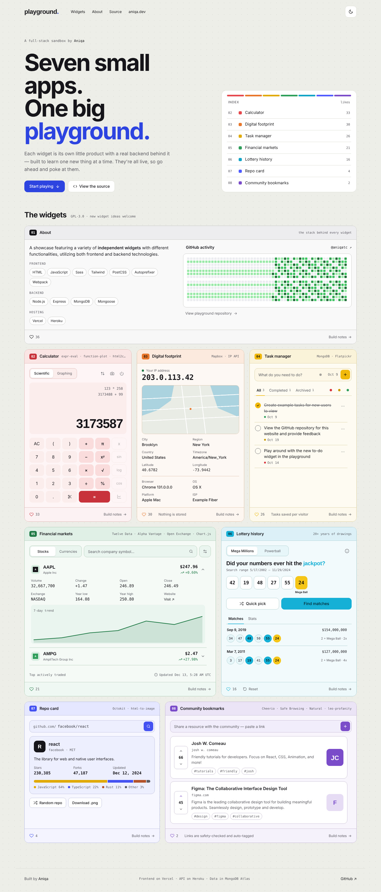
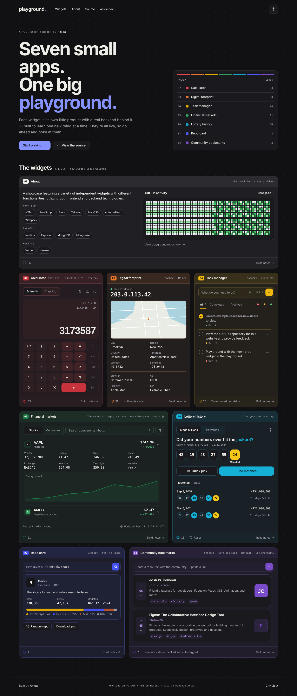
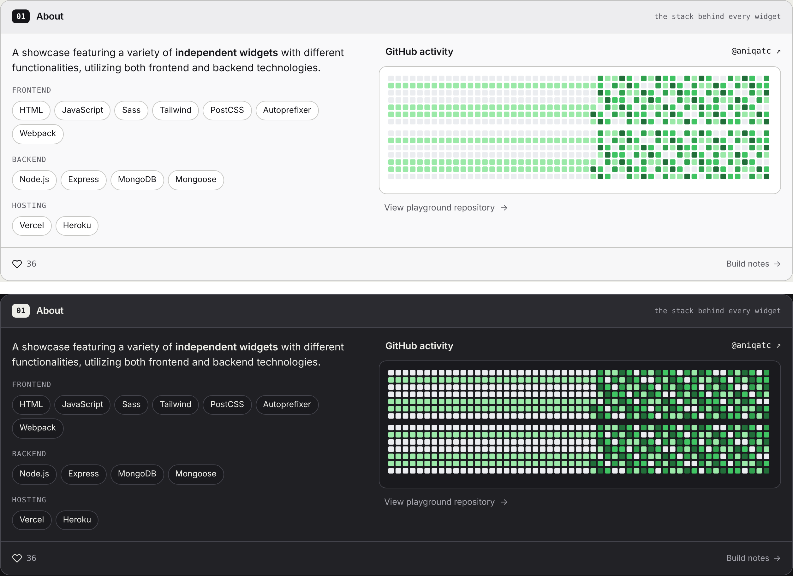
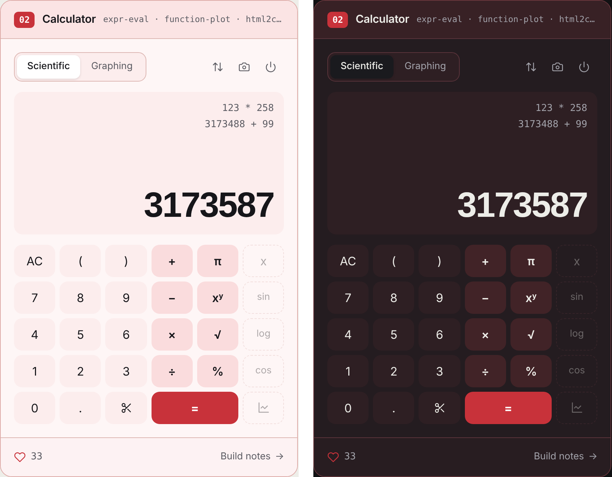
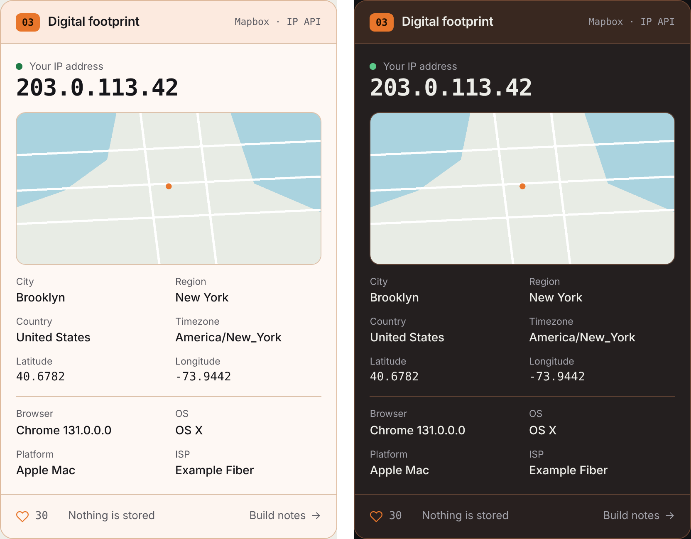
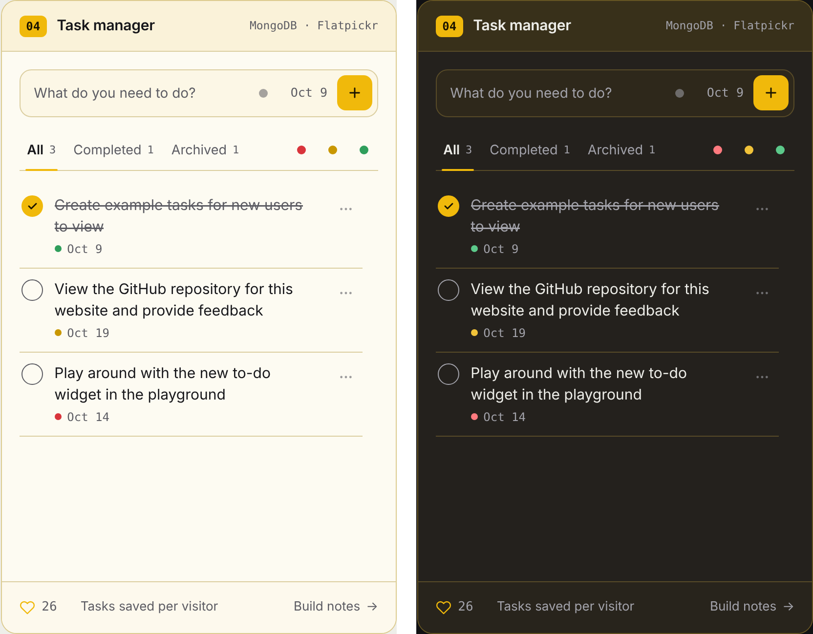
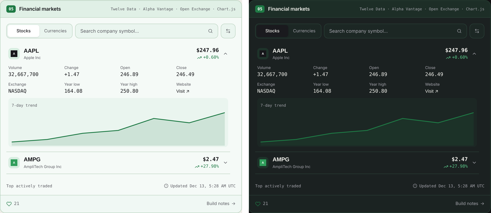
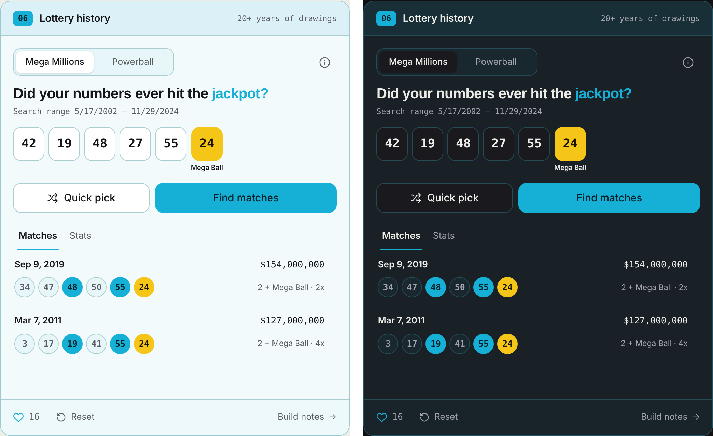
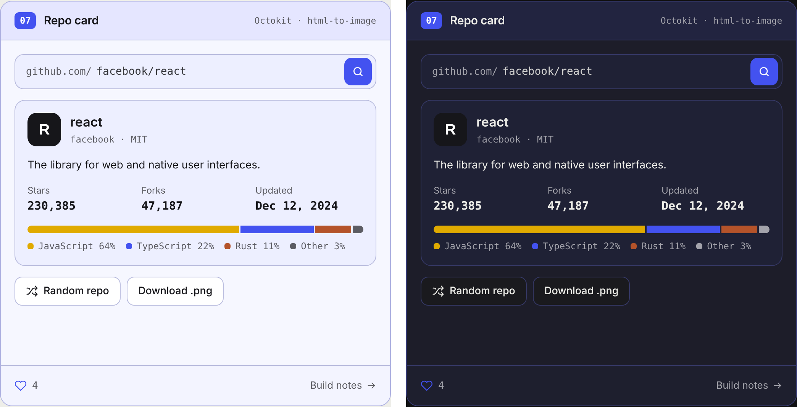
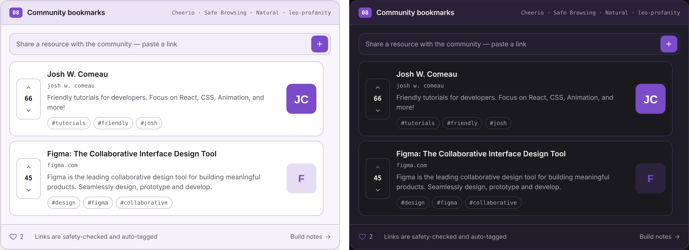

# Playground

A collection of eight independent widgets, from a graphing calculator to a community bookmark board, each built to practice a different part of full-stack development.

**[Live site](https://playground.aniqa.dev)** · [Build notes](docs/README.md)

<table>
  <tr>
    <td width="50%"><a href="https://playground.aniqa.dev"></a></td>
    <td width="50%"><a href="https://playground.aniqa.dev"></a></td>
  </tr>
</table>

## Tech

- HTML, Sass, Tailwind CSS and JavaScript, bundled with Webpack
- Node, Express, MongoDB and Mongoose
- Vercel (frontend), Heroku (backend) and MongoDB Atlas
- Each widget's extra libraries and APIs are listed under its feature below

## Features

### 01 · About

A full-width card with what the playground is for, the stack grouped into frontend, backend and hosting, my GitHub activity grid and a link to the source.

**Stack:** HTML and SCSS · [Build notes](docs/widgets/01-about.md)

<a href="https://playground.aniqa.dev"></a>

### 02 · Calculator

Evaluates expressions, graphs functions, keeps a history of what you've entered and saves the display and history as a PNG.

**Stack:** Function Plot, expr-eval and html2canvas · [Build notes](docs/widgets/02-calculator.md)

<a href="https://playground.aniqa.dev"></a>

### 03 · Digital footprint

Shows what a site can learn about you: approximate location from your IP, browser, OS and ISP, with your location on a map.

**Stack:** Express, express-useragent, ip-api and Mapbox · [Build notes](docs/widgets/03-digital-footprint.md)

<a href="https://playground.aniqa.dev"></a>

### 04 · Task manager

Tasks with priority tags, due dates and tag filters, plus edit, delay, archive and delete actions. New visitors start with a few example tasks.

**Stack:** Express, MongoDB and Flatpickr · [Build notes](docs/widgets/04-todo-list.md)

<a href="https://playground.aniqa.dev"></a>

### 05 · Financial markets

Currency rates against USD and featured stocks with 7-day price charts and color-coded trends, refreshed every weekday.

**Stack:** Express, MongoDB, Twelve Data, Alpha Vantage, Open Exchange Rates and Chart.js · [Build notes](docs/widgets/05-fin-market.md)

<a href="https://playground.aniqa.dev"></a>

### 06 · Lottery history

Search 20+ years of Powerball and Mega Millions drawings for your numbers, generate a quick pick and see match stats.

**Stack:** Express, MongoDB and RapidAPI lottery APIs · [Build notes](docs/widgets/06-lottery.md)

<a href="https://playground.aniqa.dev"></a>

### 07 · Repo card

Search for a GitHub repository or pull a random one, see its stats and language breakdown as a card and save it as an image.

**Stack:** Express, Octokit and html-to-image · [Build notes](docs/widgets/07-gh-card.md)

<a href="https://playground.aniqa.dev"></a>

### 08 · Community bookmarks

Submit a link and it gets a title, description and topic tags automatically. Vote links up or down and browse them as cards with their topic tags.

**Stack:** Express, MongoDB, Cheerio, Google Safe Browsing, natural and leo-profanity · [Build notes](docs/widgets/08-bookmarks.md)

<a href="https://playground.aniqa.dev"></a>

## Design

- Light and dark modes from one set of design tokens (CSS custom properties)
- A shared card shell gives every widget a numbered header, tech tags, a like button and a build notes link
- A 12-column grid mixes wide and narrow cards, with Bricolage Grotesque, Geist and Geist Mono

## Accessibility

- Toggles and likes report state with `aria-pressed`, menus with `aria-expanded`
- Calculator and lottery results are announced through live regions
- Form errors are marked with `aria-invalid`
- Visible focus styles, and animations respect reduced motion

## Project structure

```plaintext
playground/
├── client/                  # Frontend (Vercel)
│   ├── src/
│   │   ├── main/            # Page shell: index.html, styles, theme, users, likes, widget loading
│   │   └── widgets/
│   │       ├── _card.js     # Shared card shell (header, tech tags, like button, build notes link)
│   │       ├── 01/          # About
│   │       ├── 02/          # Calculator
│   │       ├── 03/          # Digital footprint
│   │       ├── 04/          # Task manager
│   │       ├── 05/          # Financial markets
│   │       ├── 06/          # Lottery history
│   │       ├── 07/          # Repo card
│   │       └── 08/          # Community bookmarks
│   ├── webpack.config.js    # Bundling, Sass/PostCSS, env variables, PWA manifest
│   └── tailwind.config.js
├── server/                  # Backend (Heroku)
│   ├── main/                # User and like models and routes
│   └── widgets/             # API routes, models and data fetching for widgets 03–08
├── server.js                # Express setup, routes and scheduled data refreshes
├── Procfile                 # Heroku start command
└── docs/                    # Build notes for the site and each widget, plus screenshots
```

Each widget folder follows the same layout:

```plaintext
05/
├── content.js    # The widget's HTML
├── script.js     # Entry point that wires up the widget
├── style.scss    # Widget styles
└── core/         # One module per job (charts.js, stockSearch.js, currencyCard.js, ...)
```

## Key concepts

- **One widget, one new skill.** Each widget let me learn something new: third-party APIs, MongoDB models, scraping, image export or text processing.
- **Scheduled data instead of live calls.** Free API tiers allow too few requests for every visitor, so `node-cron` refreshes stocks and currencies each weekday and lottery results monthly into MongoDB.
- **Accounts without sign-up.** A random ID in localStorage ties tasks and likes to a visitor.
- **Processing user submissions.** Bookmarks are scraped with Cheerio, checked with Google Safe Browsing, tagged with natural and filtered with leo-profanity before saving.

## Setup

Requires Node 18+, a MongoDB database and API keys for the widgets you want to run.

**Server** (`.env` in the root, see `.env.example`):

| Variable | Where to get it |
| --- | --- |
| `DB_URI`, `DB_PW` | MongoDB Atlas connection string with `<PASSWORD>` in place of the password, and the password |
| `FRONTEND_LOCAL`, `FRONTEND_HOSTED` | Allowed CORS origins, e.g. `http://localhost:8080` |
| `ALPHA_VANTAGE_API_KEY` | [Alpha Vantage](https://www.alphavantage.co/support/#api-key) |
| `TWELVE_DATA_API_KEY` | [Twelve Data](https://twelvedata.com/) |
| `OPEN_EXCHANGE_API_KEY` | [Open Exchange Rates](https://openexchangerates.org/) |
| `LOTTERY_API_KEY` | [RapidAPI](https://rapidapi.com/) Powerball and Mega Millions APIs |
| `GH_API_KEY` | GitHub personal access token |
| `GOOGLE_API_KEY` | Google Cloud, with the Safe Browsing API enabled |

**Client** (`client/.env.development`, see `client/.env.development.example`):

| Variable | Where to get it |
| --- | --- |
| `SERVER` | API URL, `http://localhost:3000` locally |
| `MAPBOX_KEY` | [Mapbox](https://account.mapbox.com/) access token |

```bash
git clone https://github.com/aniqatc/playground.git
cd playground
npm install && npm run start:dev    # API on port 3000
cd client
npm install && npm start            # site on port 8080
```

## Scripts

| Command | Where | What it does |
| --- | --- | --- |
| `npm run start:dev` | root | API in development (local CORS origin) |
| `npm start` | root | API in production (Heroku) |
| `npm start` | client | Dev server |
| `npm run build` | client | Production build |
| `npm run lint` / `lint:fix` | client | ESLint (`lint:server` in root) |
| `npm run format` | client | Prettier (`format:server` in root) |

## Changelog

### October 2026

- Redesigned at my direction with Claude's help; every widget's functionality is unchanged
- Shared design tokens, card shell and 12-column grid replaced per-widget colors and equal-width cards
- Original design screenshots are in [docs/screenshots](docs/screenshots)

### February 2025

- Example `.env` files and improved loading states

### September–December 2024

- Added the task tracker, financial markets, lottery search, GitHub cards and community bookmarks widgets

### December 2023

- Initial release with About, Calculator, Digital footprint and likes

## License

[GPL-3.0](LICENSE). New widgets are welcome; see the [widget templates](docs/widgets/widgetTemplates.md).
